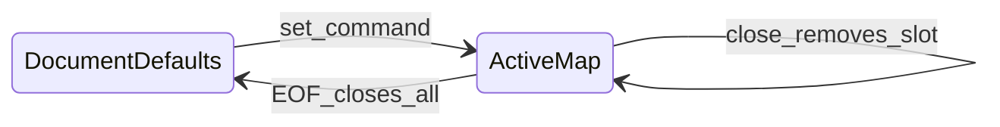

# BFMD (Better Formatted Markdown)

**Source:** Sickle (native text-note format). Banter adapts this same BFMD language for chat/message text formatting (Owl, 2026-11-04). When bold/italic and related styles leave deferred, implement against this spec — not CommonMark.

### 1. Status and goals

- **Native storage** for Sickle text notes (and Banter messages when formatting lands). Not markdown, not RTF, not HTML. The name is **Better Formatted Markdown**; the on-disk language is the command format in this spec, not CommonMark.
- **Export later** to `.md` and `.docx` (mapping in §11). Export is not required for v1 of the app.
- Formatting is a **style state machine**: command groups mutate active properties; following text uses that state until a property is replaced, closed, or the file ends.

### 2. File identity

| Field | Value |
| --- | --- |
| Extension | `.bfmd` |
| Encoding | UTF-8. BOM tolerated on read; **do not write a BOM**. |
| Newlines | LF canonical. CRLF accepted on read; rewrite as LF on save. |
| Version | Format version **1**. Optional first command `{v:1}`. Missing `{v}` means version 1. |
| Media hint | `text/x-bfmd` |

A file is a sequence of **text** and **command groups**. There is no required header, trailer, or closing tag. **Every still-open command is implicitly closed at EOF.**

### 3. Model (not HTML)

`<>` does **not** wrap a region the way `<b>...</b>` does. A group is an **inline control** that updates a map of active style slots. Text after the group is rendered with the current map.

```
<{s:36},{c=0xFFFFFF},{b:t}> Text Goes Here <{!s},{!c}> This is still bold.
```

- After the first group: size 36, color white, bold on.
- After the second group: size and color revert to document defaults; **bold stays on**.
- EOF closes bold even if `{!b}` was never written.

```
<{s:36}> Text is size 36 <{s:42}> This is size 42.
```

- `{s:42}` **replaces** the active `s` slot. The previous size is closed automatically. There is no stack of sizes to pop.

Active style is a **map** (`name → value`), not a nestable stack.



### 4. Lexical grammar

```
document     = { item }
item         = text | group | escape
group        = '<' ws command_list ws '>'
command_list = command { ws ',' ws command }
command      = set | close | close_all
set          = '{' name assign value '}'
close        = '{!' name '}'
close_all    = '{!}' | '{!*}'
assign       = ':' | '='
name         = [a-z] [a-z0-9]*
value        = number | bool | hex | hashhex | ident | quoted
number       = [0-9]+ { '.' [0-9]+ }
bool         = 't' | 'f' | 'true' | 'false' | '1' | '0'
hex          = '0x' hexdigit{6} | '0x' hexdigit{8}
hashhex      = '#' hexdigit{6} | '#' hexdigit{8}
ident        = [A-Za-z0-9_\-]+
quoted       = '"' { char_or_escape } '"'
ws           = { ' ' | '\t' }
```

**Group start rule**: `<` begins a group only when it is followed by optional whitespace and then `{`. Otherwise `<` is literal text.

**`:` and `=` are equivalent.** Both assign. Canonical write form is in §9.

**No spaces inside `{...}`** on write. Spaces around commas and inside `<>` outside braces are allowed on read.

Names are **case-sensitive and lowercase**. `{S:36}` is unknown (see §8).

Boolean values are case-insensitive (`T`, `True` ok).

### 5. Escapes

`\` is the escape character in **text** (not inside `{...}` values except quoted strings).

| Sequence | Meaning |
| --- | --- |
| `\<` | literal `<` (even when followed by `{`) |
| `\{` | literal `{` |
| `\>` | literal `>` |
| `\}` | literal `}` |
| `\\` | literal `\` |
| `\n` | newline (optional; raw newlines in text are also newlines) |

Unknown escape: keep the character after `\`, drop the slash (`\q` → `q`), emit a diagnostic.

Inside quoted values, `\"` and `\\` are the only required escapes.

### 6. Commands (v1)

Document defaults (slots empty): theme foreground, theme body size (**16pt**), theme font, not bold/italic/underline/strike, no highlight, align inherit (start), heading none.

**Flag commands** (`b`, `i`, `u`, `k`, `hr`): omitted value means `t`. `{b}` == `{b:t}`. `{b:f}` turns the slot off (same as `{!b}`).

| Name | Slot | Value | Effect |
| --- | --- | --- | --- |
| `v` | file | integer | Format version. Only meaningful as the first group in the file. Unknown future versions: parse what is recognized, warn. |
| `s` | size | number | Font size in **points**. Must be `> 0`. `{s:36}` → 36pt. |
| `e` | emote size | number | Inline **emote** height in **CSS px** (BA-83). Independent from `{s}`. Default **22** when unset. Values clamp to **16–128**. `{e:48}` → 48px emotes until `{!e}`. |
| `c` | color | hex | Foreground. `{c=0xFFFFFF}` or `{c:#FFFFFF}`. 8-digit form is RGBA. |
| `bg` | background | hex | Highlight / text background. |
| `b` | bold | bool | Bold. `{b:t}` |
| `i` | italic | bool | Italic. |
| `u` | underline | bool | Underline. |
| `k` | strike | bool | Strikethrough. |
| `f` | font | ident or quoted | Family override. Unknown names fall back to theme font. |
| `a` | align | `l` `c` `r` `j` | Paragraph align from this point until next `a` or `{!a}`. Applies to the paragraph containing the command and following paragraphs. |
| `h` | heading | `1`..`6` | Heading level until `{!h}` or another `h`. Used for title and for export. **Semantic only** — not a font-size preset. Applying `{h}` must not set, replace, or close `{s}`. The renderer does **not** substitute a heading size table; body size is theme `size_note` unless `{s}` is set. |
| `hr` | rule | bool | Horizontal rule. `{hr}` == `{hr:t}` (flag; omitted value means `t`). `{hr:f}` is the same as `{!hr}`. While the slot is on, the renderer draws a full-width rule for that paragraph (theme `border`, or the active `{c}` if set). Keep the style-map model; this is not HTML `<hr>`. |

**Close**: `{!s}` removes slot `s` (revert that property to default). `{!e}` restores the 22px emote default. `{!}` or `{!*}` clears **all** slots.

**Emote tokens (not BFMD commands):** message bodies may include stable `:{e:ASSET_ID}:` tokens for custom library emotes. Display size follows the active `{e}` slot (default 22px). Stickers and GIFs are message media, not BFMD tokens.

### 6.1 Timestamps (inline objects — Owl-approved)

Timestamps are **inline objects**, not style slots. They do not stay “on” for following text. A timestamp run carries an absolute Unix instant plus a display style; paint formats it in the **reader’s** local timezone/locale. Canonical storage/serialize form is always the Discord tag.

#### Discord-style

```
<t:UNIX_SECONDS>
<t:UNIX_SECONDS:STYLE>
```

- `UNIX_SECONDS` is a signed integer (UTC epoch seconds). Negative values (pre-1970) are allowed.
- `STYLE` is one letter. Omitted style means `f`.
- Supported flags (Discord usual set):

| Flag | Name | Render |
| --- | --- | --- |
| `t` | short time | `03:01 PM` |
| `T` | long time | `03:01:00 PM` |
| `d` | short date | `11/09/2026` |
| `D` | long date | `November 09, 2026` |
| `f` | short date + short time (**default**) | `November 09, 2026 03:01 PM` |
| `F` | full date + short time | `Monday, November 09, 2026 03:01 PM` |
| `R` | relative | `in 2 days` / `3 hours ago` |

Malformed tags (`<t:abc>`, unknown style letter, missing `>`) stay **literal text**. Escape with `\<t:…>` to force a literal.

#### Easy plain-text `@t[…]` (Owl)

Designed to be easier to type than Discord tags. **Requires the exact marker `@t[`** (no space between `@t` and `[`) so ordinary sentences never false-match.

```
easy_timestamp = '@t[' datetime [ ws style ] ']'
datetime       = date sep time [ ws offset ]
date           = YYYY '-' MM '-' DD
sep            = ' ' | 'T'
time           = HH ':' MM [ ':' SS ]              ; 24-hour
               | h  ':' MM [ ':' SS ] ws meridiem  ; 12-hour
meridiem       = 'AM' | 'PM' | 'am' | 'pm' | 'A.M.' | 'P.M.'
offset         = 'Z' | ('+'|'-') HH [':' MM] | ('+'|'-') HHMM
style          = 't' | 'T' | 'd' | 'D' | 'f' | 'F' | 'R'
```

**Examples**

| Source | Meaning |
| --- | --- |
| `@t[2026-11-09 13:00]` | 13:00 on that date in the **writer’s local** zone; style `f` |
| `@t[2026-11-09 1:00 PM R]` | 13:00 local, relative display |
| `@t[1970-01-01 00:00:00Z]` | Unix 0 (UTC) |
| `@t[1970-01-01T00:00:00+00:00 t]` | Unix 0, short time |
| `@t[2026-11-09 12:00 AM -05:00]` | midnight Eastern |

**Ambiguity / false-positive rules**

1. Only `@t[`…`]` is recognized. Bare ISO dates, `owl@test.com`, `@t [spaced]`, `$t[…]`, and `array[1970-01-01]` are literal.
2. If the brackets are missing/unclosed, or the interior fails the grammar (bad date, bad time, unknown trailing token that is not a style flag), the whole `@t[…]` (or `@t[` prefix) stays literal.
3. A trailing single-letter token is a style **only** when it is one of `t T d D f F R`. Otherwise the interior is invalid → literal.
4. When **no offset/`Z`** is given, the datetime is interpreted in the **writer’s local timezone at parse time**, then stored as a Unix instant. Canonical serialize always emits `<t:unix:style>` so later readers are unambiguous.

**Replace**: a new `set` for a name that is already active **closes the previous value and applies the new one**. No history of the old value is kept.

**Unknown name**: skip that command, keep parsing the group, record a diagnostic. Do not abort the file.

**Bad value**: skip that command, diagnostic.

### 7. Normative examples

**Example A** — close some slots, leave others:

Source:

```
<{s:36},{c=0xFFFFFF},{b:t}> Text Goes Here <{!s},{!c}> This is still bold.
```

Parsed runs:

1. text ` Text Goes Here ` — `{s:36, c:0xFFFFFF, b:true}`
2. text ` This is still bold.` — `{b:true}` (size and color default)

**Example B** — same command replaces:

Source:

```
<{s:36}> Text is size 36 <{s:42}> This is size 42.
```

Parsed runs:

1. text ` Text is size 36 ` — `{s:36}`
2. text ` This is size 42.` — `{s:42}` (36 is gone; no stack pop)

**Example C** — implicit EOF close (no trailing group required):

Source:

```
<{b:t},{i:t}>hello
```

Runs: `hello` with bold+italic. After EOF, no commands remain open. A writer is not required to emit `{!b},{!i}`.

**Example D** — literal angle bracket:

Source:

```
use \<{s:12}> as text
```

Runs: one text run `use <{s:12}> as text` with default style.

**Example K** — Discord timestamp:

Source:

```
see you <t:1700000000:R>
```

Parsed runs: text `see you `, then a timestamp object (unix `1700000000`, style `R`).

**Example L** — easy `@t[…]` (normalizes on serialize):

Source:

```
@t[1970-01-01 00:00:00Z R]
```

Parsed: one timestamp run (unix `0`, style `R`). Canonical serialize: `<t:0:R>`.

**Example E** — `{b}` shorthand and align:

Source:

```
<{h:1},{s:28}>Title
<{!h},{!s},{a:c},{b}>centered bold
```

### 8. Errors and diagnostics

The editor **must not refuse to open** a note because of parse errors. Recover:

- Unclosed `<{` (EOF before `>`): treat from `<` as literal text; diagnostic.
- Nested `<{` inside a group: close the current group at the inner `<` (as if `>` was inserted), diagnostic, then start the new group.
- Trailing comma in a group: ignore.
- Empty group `<>` or `<{}>`: no-op.

Diagnostics are in-memory (status line / palette), not written back into the file.

### 9. Canonical write form

When the editor serializes `.bfmd`:

1. Emit a group only when the style map **changes**.
2. In a group, emit only slots that changed (sets and closes).
3. Assignment: `:` for numbers, bools, idents, headings, align; `=` for hex colors (matches the examples).
4. Booleans as `t` / `f`.
5. Colors as `0xRRGGBB` or `0xRRGGBBAA` (uppercase hex).
6. No spaces inside `{...}`; `,` with no spaces between commands.
7. Do not emit redundant `{!x}` at EOF.
8. Do not emit `{v:1}` unless the in-memory version is not 1.
9. Preserve user paragraph breaks (raw `\n`).
10. Do not rewrite the file on open if the buffer is not dirty.

Round-trip of Examples A and B must be semantically identical (same runs). Byte-identical round-trip is a goal for files already in canonical form.

### 10. Editor behavior (implements the spec)

- **Source of truth**: the `.bfmd` bytes on disk.
- **In-memory**: `ropey` of source **or** a span model that can serialize to canonical `.bfmd`. Prefer a span/run model plus a serializer so typing does not require the user to edit commands.
- **Display**: WYSIWYG runs. Command groups are not shown in the viewport unless a future “show codes” view is added (out of v1).
- **Typing**: inserts text into the current run; inherits the style of the character/run **immediately before** the caret (not after, not document default). At a run boundary or in empty space after text, that is the preceding run. At the start of the document there is no preceding character, so slots are empty (theme default). Example: after a heading, moving the caret to the end of that heading then typing continues as heading until the user clears it (`{!h}` or Body / Normal).
- **Body / Normal**: editor action that closes heading, size override, alignment, and extra emphasis — `{!h},{!s},{!a}` and typically `{!}` so following text is theme default. Exposed in Format ▾ and the right-click menu (optional shortcut Ctrl+0).
- **Font size**: `{s:N}` is a free point size (any `N > 0`, including fractions such as `13.5`). The UI exposes a numeric field (not only presets). Headings are a separate control.
- **Format ▾ / shortcuts**: at the caret or selection, emit the equivalent state change (set/replace/close). Selection that crosses runs must split runs and apply the slot to the selected range (close after the selection if the style after the selection should revert — same as “apply then `{!name}` after the range” when the post-selection slot differed).
- **Lazy file create**: do not write `untitled.bfmd` until the buffer is dirty.
- **Title**: first visible text of an `{h:1}` run; else first visible line; else stem.

### 11. Export mapping (specify now, implement later)

Not in the v1 app cut. Exporters must read this table so the native format does not grow features that cannot leave the app.

**Markdown**

- `{h:n}` → `n` times `#` + space at paragraph start; `{!h}` / new `h` ends it.
- `{b:t}` → wrap run in `**` (escape inner `*`).
- `{i:t}` → wrap run in `*` .
- `{u:t}` `{k:t}` `{c}` `{bg}` `{s}` `{f}` → HTML `<span style="...">` / `<u>` / `<s>` inside the `.md` file (lossy-but-faithful). Plain-md mode may drop these.
- `{a:c}` / `{a:r}` / `{a:j}` → HTML align on the paragraph.
- `{hr}` → Markdown `---` / HTML `<hr>` (lossy).
- `<t:unix:style>` / `@t[…]` → keep Discord `<t:…>` in Markdown export (or render a static locale string in plain-md mode).
- Command groups themselves are never written to the export.

**DOCX**

- Map slots onto `w:rPr` / `w:pPr`: `b`, `i`, `u`, `strike`, `sz` (half-points = pt×2), `color`, `highlight`/`shd`, `jc`, heading outline via paragraph style `Heading n`.

### 12. Conformance tests (Agent B must implement)

These are **required unit tests**, inputs taken as exact source strings:

1. Example A → two runs, bold remains after close of `s` and `c`.
2. Example B → two runs, sizes 36 then 42, no stacked restore.
3. Example C → one run; parser does not require trailing closes.
4. Example D → no style; text contains `<{s:12}>`.
5. `{s:36}` then `{s:42}` then `{!s}` → third run is default size.
6. `{!}` clears bold+size together.
7. Unknown `{z:1}` is ignored; following `{b:t}` still applies.
8. `<` not followed by `{` is literal.
9. Both `{c=0xFFFFFF}` and `{c:#FFFFFF}` yield the same RGB.
10. `{hr}` / `{hr:t}` then a newline then `{!hr}` → one run whose style has `hr` on; `{!hr}` (or `{hr:f}`) clears the slot for following text.
11. `<t:0>` → timestamp run, unix 0, style `f`; `<t:1700000000:R>` → relative style.
12. `@t[1970-01-01 00:00:00Z R]` → unix 0, style `R`; serialize → `<t:0:R>`.
13. Ordinary `meet on 2026-11-09 at 13:00` has **no** timestamp runs (no `@t[` marker).

### 13. Out of scope for this format

- Embedded images or board ink (those are **AGWF** documents or future `{img:"..."}` — do not add until specified here).
- Macros, scripts, or arbitrary command execution. `{...}` is a **closed set of style commands**, not a programming language.
- Nested / stacked values for the same slot.
- Other Discord markdown (spoilers `||…||`, lists, quotes, masked links, mentions, etc.) unless Owl explicitly approves that feature. **Timestamps are approved** (Discord `<t:…>` + easy `@t[…]` only).
