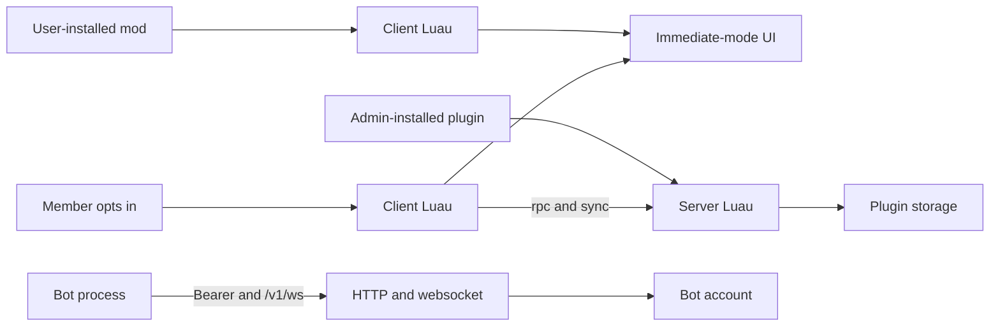

# Modding

Specification for three ways to extend Banter. The desktop client and `banter-server` do not load these packages yet. This document is the contract for that work.

| Doc | What it covers |
| --- | --- |
| [Mods](mods.md) | Luau that runs on one person's client |
| [Plugins](plugins.md) | Luau installed on a server, with an optional client half |
| [Bots](bots.md) | A separate process that uses `/v1` as its own account |

## Rules

- Mods and plugin scripts are Luau. Bots are any language, over HTTP and the websocket.
- Mods stay on the installing machine.
- A plugin’s server script runs for the whole guild. The plugin sets `client` to `none`, `optional`, or `required`. `none` is server only and is never offered to members. `optional` and `required` ship a client script that runs only after that member accepts that version.
- Mods and plugin clients draw with an immediate-mode UI, called from a render function, in the style of Dear ImGui. They do not call Dear ImGui or OpenGL themselves. The host paints the calls with the Banter theme unless the mod changes that theme or sets a theme on an element.
- Enabled mods load and run in one order. That order is deterministic, and the user can change it.
- Every sensitive API is a permission (mods and plugins) or an intent (bots) that the author checks in the manifest. If it is not checked, the call returns nil and does nothing. The user or admin sees that list before the addon runs.
- `io` and `os` are available when those permissions are checked. They add a second warning: Banter is not responsible for addons that modify your files, plus a plain list of what this addon declared.
- A mod declares how much memory it requires. More than 150 MB adds another warning. Each mod has its own process rate. That rate stays locked unless the person running the mod turns the lock off for that mod.
- A bot is a real account with `bot: true` and a token. Its intents are the checklist on the bot.
- Custom channel kinds belong to plugins. Built-in channel-type templates stay canceled.



## Shared rules

Banter today: desktop client in [crates/banter](../../crates/banter), server in [crates/banter-server](../../crates/banter-server). Auth is `Authorization: Bearer <token>`. Errors are JSON `{"error": "<sentence>", "code": "<snake_case>"}`. Websocket frames are JSON text. Server pushes use `ServerEvent` (`kind` tag) in [crates/banter-server/src/model.rs](../../crates/banter-server/src/model.rs). Client pushes use `ClientSignal` the same way. `channels.kind` is already `TEXT`. The Rust enum currently accepts only `text`, `voice`, and `board`.

### Who runs what

- **Mod.** A person enables it in User Settings. It runs in their client only. Other members do not download it.
- **Plugin.** A server owner, or a member with `manage_plugins`, installs it on one server. The server script runs inside `banter-server` for that server. The client script is offered to members. Each member accepts or skips each version.
- **Bot.** A person creates a bot account, puts the token on their own process, and a server admin adds the bot to a server with a permission list. Banter never loads the bot’s code.

### Script sandbox

Applies to every mod state and every plugin state.

- Language: Luau. Always present: `math`, `string`, `table`, `coroutine`, `utf8`, `bit32`, `buffer`, `vector` when the runtime provides it.
- `io` and `os` are present only as tables of functions. Each function returns nil and does nothing unless the package checked `io` or `os`. `debug` stays unavailable. `require` cannot read outside the package, and `loadstring` of arbitrary source stays unavailable.
- `require` resolves only inside that package, relative, with no `..` path segments.
- Values that cross the host boundary are JSON-like: `nil`, boolean, number, string, array, and string-keyed tables. Host functions are the exception and are not stored in plugin storage or sync state.
- Process rate is per mod and per plugin state. One callback may run 1,000,000 Luau instructions and 50 ms of wall time. That budget is not shared with other mods. Past either limit the host stops that callback and reports `instruction_limit` or `time_limit`, which is a hard error. A mod author cannot raise this rate. The person running a mod can turn the lock off for that mod only. See [Mods](mods.md).
- A mod's memory cap is the `memory_mb` it declares. See [Mods](mods.md). A plugin client state is capped at 8 MB. A plugin server state is capped at 16 MB.
- If the package did not check the permission for a host function, that function returns nil and does not perform the action, including writes. When the permission is checked, the function returns its normal value, or throws a Luau error string equal to a `code` below.
- A script never receives the user token, the bot token, or a database handle.

Shared error codes for scripts, used only after the permission is checked: `invalid`, `not_found`, `forbidden`, `conflict`, `limit`, `instruction_limit`, `time_limit`, `memory_limit`.

### Permissions and the two warnings

Mods and plugins list `permissions` in the manifest. Bots list `intents`. The author checks the entries they need. A call whose entry is missing returns nil. A call whose entry is present runs, and can still fail with a real error.

Before a mod is enabled, or a plugin client is accepted, Banter shows the checked list in plain language. Allow loads it. Cancel leaves it off.

When the checked list contains `io` or `os`, Allow on the first dialog opens a second dialog and does not load the addon yet:

- Title: the addon name
- Body: “Banter is not responsible for addons that modify your files.”
- Then one line for each invasive permission this addon checked:
  - `io`: “This mod can read and write files on this computer.”
  - `os`: “This mod can run programs, read environment variables, and use other operating system functions.”
- For a plugin server script, the same dialog is shown to the admin, and the lines say “this server” instead of “this computer”: the files and programs are on the machine running `banter-server`.
- Buttons: Allow and Cancel. Cancel does not load the addon. Both dialogs must be allowed.

A plugin client uses the member’s computer, so the member sees the second dialog when the client permission list contains `io` or `os`. A plugin server uses the server machine, so the admin sees it when the server permission list contains them.

Bots do not get these dialogs. Their code runs on the bot host. The admin who adds the bot sees the intent checklist. Unchecked intents return JSON `null` with HTTP 200 and do not change anything.

### Identifiers

- Package id: `^[a-z][a-z0-9_]{1,31}$`
- Version: `MAJOR.MINOR.PATCH` with decimal integers, no prefix.
- API generation in the manifest: `"banter": "1"`. A runtime that does not speak that generation refuses to load the package.
- Storage keys: `^[A-Za-z0-9_.:-]{1,64}$`

### Render function

Mods and plugin client scripts share this. The entry registers one function:

```lua
banter.render(function()
  if banter.ui.begin("stage.header.actions") then
    banter.ui.text("Hello")
    if banter.ui.button("Ping") then
      banter.log("info", "ping")
    end
    banter.ui.close()
  end
end)
```

The host calls that function every frame the addon is running, on the client thread, before paint. Mods run in the load order from [Mods](mods.md). Plugin client scripts run after those mods, ordered by plugin id. Calls inside a render function build the frame in order, the same way Dear ImGui does. There is no widget tree to return. Without the `ui` permission, `banter.render` and every `banter.ui` function return nil and draw nothing.

Every widget uses the Banter theme from [crates/banter/src/theme.rs](../../crates/banter/src/theme.rs) unless the mod changes it. See [Mods](mods.md) for `banter.theme` and per-element theme tables.

`begin(name)` pushes a region and returns true when that region is on screen. `close()` pops the current region. Regions nest. Names:

- `rail.bottom` — under the server icons. Max height 240.
- `sidebar.footer` — above the voice and user bars. Max height 160.
- `stage.header.actions` — the channel header’s right side, after the built-in buttons.
- `composer.toolbar` — one 32px row above the message composer.
- `members.above` — top of the member list. Max height 120.
- `settings.page` — a User Settings entry named by the package.
- `home.section` — an extra block on the Home landing.
- `menu.message`, `menu.channel`, `menu.member` — extra context-menu rows. Inside these, only `button` is drawn. `banter.ui.menu_target()` returns the id the menu was opened on, or nil.
- `stage` — the center stage. A second argument is the kind filter: `banter.ui.begin("stage", "text")` or `banter.ui.begin("stage", "chess.match")`. See [Mods](mods.md) and [Plugins](plugins.md) for who is allowed to claim a kind.

Inside an open region:

- `text(value, style, theme)` — `style` is `body` | `muted` | `heading` | `danger`. Default `body`. `theme` is optional.
- `button(label, style, theme)` → true on the frame it is clicked. `style` is `normal` | `primary` | `danger`. `theme` is optional.
- `input_text(label, text, multiline, theme)` → the text after this frame. `multiline` defaults to false. `theme` is optional.
- `list(label, items, selected, theme)` → the selected item id. `items` is `{ { id, label, icon } }`. `theme` is optional.
- `image(source, w, h)` — `source` is `{ kind = "lucide", name = "<id>" }`, `{ kind = "package", path = "icon.png" }`, or `{ kind = "avatar", user_id = <n> }`.
- `separator(theme)` — `theme` is optional.
- `same_line()`
- `begin_child(id, w, h, theme)` → true when the child is open. Pair with `close()`. `theme` is optional.
- `canvas(id, w, h, draw)` — `w` and `h` at most 2048. `draw` receives a recorder: `rect(x, y, w, h, color)`, `line(x1, y1, x2, y2, color, thickness)`, `text(x, y, text, color, size)`, `image(x, y, w, h, source)`. `color` is `0xRRGGBB` or `0xAARRGGBB`. At most 2000 draw calls; the rest are dropped and a warning is recorded. `banter.ui.pointer(id)` returns `{ kind = "down"|"move"|"up", x, y, button }` or nil this frame.

When the render function returns, any region still open is closed by the host, from the inside out. Each one records a soft error naming the addon and the region, for example `clock_bar left 'stage.header.actions' open`. A `close()` with nothing open records a soft error and does nothing else. The frame still paints, using the auto-closed stack.

`banter.shell` exists only for mods, and is specified in [Mods](mods.md).

### Soft errors, hard errors, and warnings

Every addon has three lists, shown in its Settings page and in the developer log.

- **Soft error.** The addon keeps running. The frame or callback that caused it still finishes. The unclosed-UI case above is a soft error. The entry stays loaded and the next frame calls render again.
- **Hard error.** The host stops the addon. It destroys that Luau state and removes its UI and shell overrides. The hard error stays on the Settings row until the user enables it again. A Luau error that escapes the entry, the render function, or an event callback is a hard error. So are `instruction_limit`, `time_limit`, and `memory_limit`. `instruction_limit` and `time_limit` do not fire for a mod whose process-rate lock the user has turned off.
- **Warning.** The addon keeps running. The author can read it. It does not refuse export. Examples: the canvas dropped draw calls past 2000, storage is within 90% of its cap, or a host function returned nil because its permission is not checked (one warning per function per load).

A soft error clears after a later render finishes with a balanced `begin` / `close` stack and no new soft error. A hard error clears only when the addon is started again and the new run does not hard-error. Warnings clear when the condition stops.

### Export

Export writes a zip of a mod folder or a plugin package. Settings → Mods and the plugin packager both call it. Bots are not exported here.

Export is refused while that addon has any soft error or any hard error. The refusal lists those errors and writes no zip. Warnings are listed in the same dialog and do not refuse the export.

A mod or plugin that has never been started has nothing recorded, so export starts it for one entry run and one render, then applies the same rule. A hard error from that check leaves it stopped. A clean check leaves a mod enabled and leaves a plugin package eligible to upload.

### What this version of the docs leaves for a later doc revision

- Bot RTP (camera, screen, opus). Bots may still appear in a voice channel; they do not send media.
- A public package gallery.
- Plugin native code, WASM, or a process the server launches.
- Mods reading the microphone, camera, or screen-capture frames.
